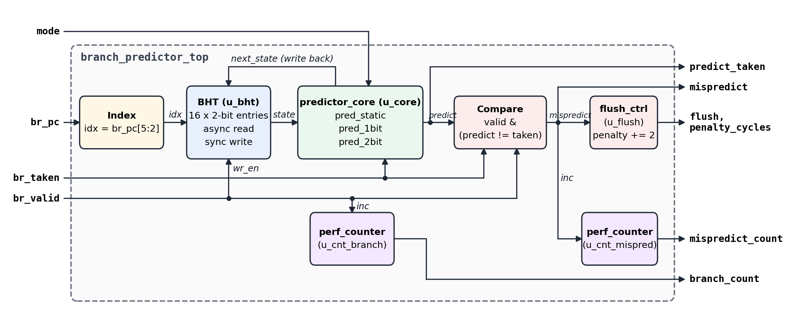
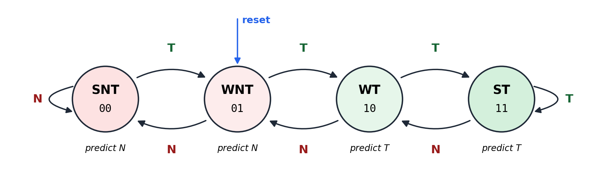

# Dynamic Branch Prediction Unit (Verilog)

**Modern Computer Architecture — MCA Project 5**

Design and evaluation of a hardware branch-prediction unit that reduces control-hazard
penalties in a pipelined processor. Three strategies are implemented in one unit and compared
on the same branch traces:

1. **Static always-not-taken** (baseline)
2. **1-bit predictor** (last outcome)
3. **2-bit saturating counter**

## Phase 1 deliverables

- IEEE report: [Phase1_IEEE_Report.pdf](docs/report/Phase1_IEEE_Report.pdf) (source: [docs/report/](docs/report/))
- Prototype video: [Google Drive folder](https://drive.google.com/drive/folders/1z4gpM2yD7AkDVKXyN4GemSsOJePdDVey?usp=sharing)

## Team

| Member | Responsibility | Files |
|---|---|---|
| Aradhya Tiwari | Project lead, integration, pipeline flush interface, performance counters, CPI analysis, video | `rtl/branch_predictor_top.v`, `rtl/flush_ctrl.v`, `rtl/perf_counter.v`, `scripts/cpi_calc.py`, `docs/interface_spec.md` |
| Mouli Srivastava | Core RTL: static, 1-bit and 2-bit predictors, predictor core | `rtl/pred_static.v`, `rtl/pred_1bit.v`, `rtl/pred_2bit.v`, `rtl/predictor_core.v` |
| Yashvi | Core RTL: Branch History Table; trace generation and reference model | `rtl/bht.v`, `scripts/gen_traces.py`, `traces/` |
| Anuj | Verification: unit and system testbenches, regression, waveforms | `tb/`, `scripts/run_all.sh`, `results/accuracy.csv`, `docs/waveforms/`, `docs/diagrams/fsm_2bit.md` |
| Chaitanya | Documentation: IEEE report, architecture and FSM diagrams | `docs/report/`, `docs/diagrams/block_diagram.*`, `docs/diagrams/fsm_2bit.png` |

## Architecture



One branch is processed per clock cycle. The PC selects one of 16 Branch History Table entries
(`idx = pc[5:2]`), the predictor core predicts with the strategy chosen by `mode`
(0 = static, 1 = 1-bit, 2 = 2-bit), the prediction is compared with the real outcome, and on the
next clock edge the entry is updated and the counters are incremented. A misprediction raises
`flush` and adds 2 penalty cycles (branch resolved in EX of a 5-stage pipeline).

- Mermaid version and module table: [docs/diagrams/block_diagram.md](docs/diagrams/block_diagram.md)
- 1-bit and 2-bit state diagrams: [docs/diagrams/fsm_2bit.md](docs/diagrams/fsm_2bit.md)
- Full module contract (ports, trace format, result format): [docs/interface_spec.md](docs/interface_spec.md)



## Repository structure

```
rtl/        Synthesizable Verilog RTL (8 modules)
tb/         Testbenches: tb_predictors (unit), tb_bht (unit), tb_top (trace-driven system)
traces/     Branch traces (.mem), expected results from the reference model, trace README
scripts/    gen_traces.py, run_all.sh (regression), cpi_calc.py
results/    accuracy.csv, cpi.csv, VCD waveforms of the loop trace
docs/       Interface spec, diagrams, waveform screenshots, IEEE report
synth/      Synthesis (Phase 2, Vivado)
```

## How to run

Requires [Icarus Verilog](https://steveicarus.github.io/iverilog/) and Python 3
(macOS: `brew install icarus-verilog`, Ubuntu: `sudo apt install iverilog`).

```bash
python3 scripts/gen_traces.py     # (optional) regenerate traces + expected results
bash scripts/run_all.sh           # unit tests + 4 traces x 3 modes, compared with the reference model
python3 scripts/cpi_calc.py       # CPI impact -> results/cpi.csv
```

Expected end of the `run_all.sh` output:

```
ALL 12 CONFIGURATIONS MATCH THE REFERENCE MODEL (and both unit tests passed)
```

Run one configuration by hand:

```bash
mkdir -p build && iverilog -g2012 -o build/sim tb/tb_top.v rtl/*.v
vvp build/sim +trace=traces/loop.mem +mode=2
# RESULT trace=traces/loop.mem mode=2 branches=200 mispredicts=21 accuracy=89.50
```

Waveforms: open `results/loop_mode1.vcd` or `results/loop_mode2.vcd` in GTKWave or Surfer.

## Results (Phase 1)

Every value below is produced by the RTL simulation and matches the Python reference model.
200 branches per trace.

**Prediction accuracy** (mispredictions in brackets)

| Trace | Static | 1-bit | 2-bit |
|---|---|---|---|
| loop | 10.00% (180) | 80.00% (40) | **89.50% (21)** |
| nested_loop | 22.00% (156) | 56.00% (88) | **77.00% (46)** |
| alternating | **50.00% (100)** | 0.00% (200) | 0.00% (200) |
| random | 27.50% (145) | 63.50% (73) | **69.00% (62)** |

**Estimated CPI** with `CPI = 1 + 0.20 x mispredict_rate x 2` (speed-up vs static in brackets)

| Trace | Static | 1-bit | 2-bit |
|---|---|---|---|
| loop | 1.360 | 1.080 (1.26x) | **1.042 (1.31x)** |
| nested_loop | 1.312 | 1.176 (1.12x) | **1.092 (1.20x)** |
| alternating | **1.200** | 1.400 (0.86x) | 1.400 (0.86x) |
| random | 1.290 | 1.146 (1.13x) | **1.124 (1.15x)** |

**Key observations**

- The 2-bit counter is best on loops: one misprediction per loop exit, because one not-taken
  outcome only moves the counter from `11` to `10`, which still predicts taken.
- The 1-bit predictor mispredicts twice per loop (at the exit and at the next entry).
- On the alternating pattern both dynamic predictors are always wrong, so static is better.
  This motivates history-based (two-level / gshare) predictors in Phase 2.

**Waveforms** of the loop trace around the loop exits:

| 1-bit: two mispredicts per loop boundary | 2-bit: one mispredict per loop exit |
|---|---|
|  |  |

## Status

- [x] Project structure and interface specification
- [x] Predictor RTL (static, 1-bit, 2-bit) and predictor core
- [x] Branch History Table
- [x] Top-level integration, counters, flush control
- [x] Traces and reference model
- [x] Testbenches, regression and results (12/12 match)
- [x] CPI analysis
- [x] IEEE report (Phase 1)
- [ ] Demo video (Phase 1)

## Phase 2 plan

- Branch Target Buffer (target address prediction)
- Delayed update from the EX stage and integration into a 5-stage RV32I pipeline
  (`flush` clears the IF/ID and ID/EX registers)
- History-based predictor (gshare) and comparison on the alternating and nested-loop traces
- Vivado synthesis: resource utilisation (LUTs, FFs) and maximum frequency
- Longer, more realistic branch traces
