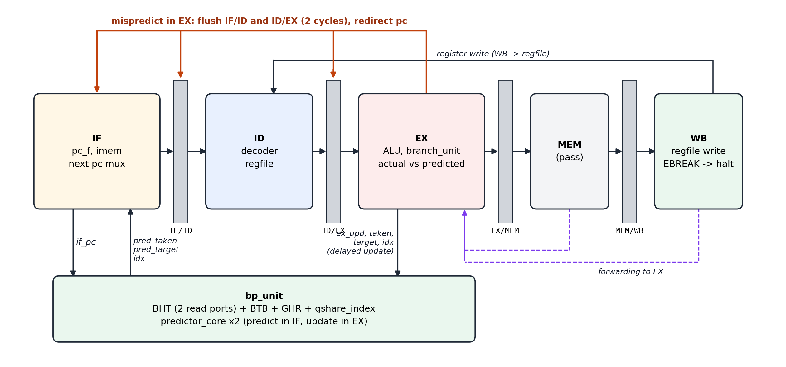
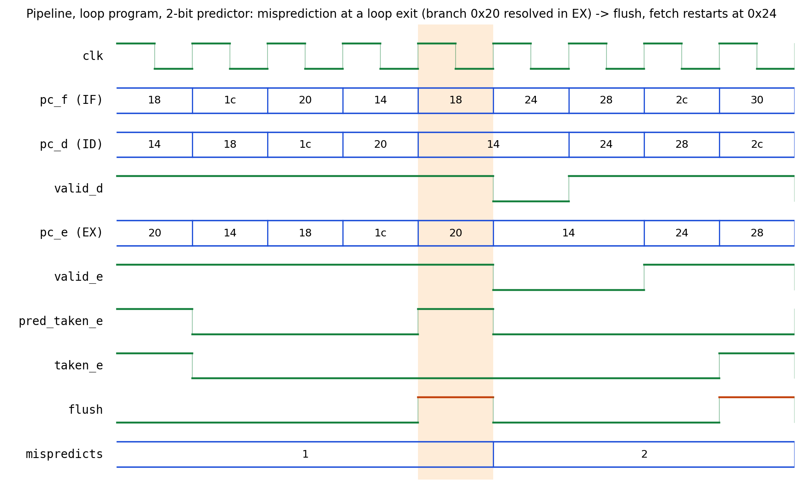
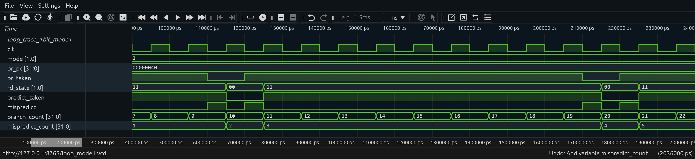
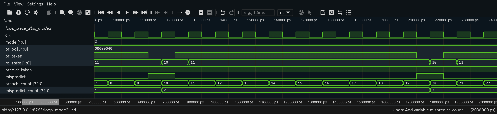

# Dynamic Branch Prediction Unit (Verilog)

**Modern Computer Architecture — MCA Project 5**

Design and evaluation of a hardware branch-prediction unit that reduces control-hazard
penalties in a pipelined processor. Four strategies are implemented in one unit and compared,
first on branch traces and then inside a 5-stage pipeline where the CPI is measured:

1. **Static always-not-taken** (baseline)
2. **1-bit predictor** (last outcome)
3. **2-bit saturating counter**
4. **gshare** (2-bit counters indexed by PC XOR global history) — Phase 2

Phase 2 also adds a **Branch Target Buffer**, a **5-stage RV32I-subset pipeline** with
delayed (EX-stage) predictor update and flush, and **Yosys synthesis**.

## Deliverables

- Final IEEE report (Phase 2): [Final_IEEE_Report.pdf](docs/report/Final_IEEE_Report.pdf) (source: [docs/report/](docs/report/))
- Phase 1 IEEE report: [Phase1_IEEE_Report.pdf](docs/report/Phase1_IEEE_Report.pdf)
- Phase 1 prototype video: [Google Drive folder](https://drive.google.com/drive/folders/1z4gpM2yD7AkDVKXyN4GemSsOJePdDVey?usp=sharing)

## Team

| Member | Responsibility | Files |
|---|---|---|
| Aradhya Tiwari | Project lead, integration, pipeline, CPI analysis, synthesis | `rtl/branch_predictor_top.v`, `rtl/bp_unit.v`, `rtl/cpu/pipeline_cpu.v`, `rtl/flush_ctrl.v`, `rtl/perf_counter.v`, `scripts/cpi_calc.py`, `synth/`, `docs/interface_spec.md` |
| Mouli Srivastava | Predictor and data-path RTL | `rtl/pred_*.v`, `rtl/predictor_core.v`, `rtl/ghr.v`, `rtl/gshare_index.v`, `rtl/cpu/alu.v`, `rtl/cpu/regfile.v`, `rtl/cpu/decoder.v`, `rtl/cpu/branch_unit.v` |
| Yashvi | Tables, traces, programs, reference models | `rtl/bht.v`, `rtl/btb.v`, `scripts/gen_traces.py`, `scripts/asm.py`, `scripts/iss.py`, `traces/`, `programs/` |
| Anuj | Verification | `tb/`, `scripts/run_all.sh`, `scripts/plot_vcd.py`, `results/` (except `cpi*.csv`), `docs/waveforms/`, `docs/diagrams/fsm_2bit.md` |
| Chaitanya | Documentation | `docs/report/`, `docs/diagrams/block_diagram.*`, `docs/diagrams/pipeline_diagram.*`, `docs/diagrams/fsm_2bit.png` |

## Architecture

**Trace-driven unit** (`branch_predictor_top`): one branch per clock, predicted and updated in
the same cycle; used to measure prediction accuracy.


**Pipeline** (`pipeline_cpu` + `bp_unit`): the unit predicts in IF (direction + BTB target) and
is updated in EX, two cycles later; a misprediction flushes IF/ID and ID/EX (2 cycles).



- Details: [block_diagram.md](docs/diagrams/block_diagram.md), [pipeline_diagram.md](docs/diagrams/pipeline_diagram.md),
  [fsm_2bit.md](docs/diagrams/fsm_2bit.md), [programs/README.md](programs/README.md), [traces/README.md](traces/README.md)
- Full module contract: [docs/interface_spec.md](docs/interface_spec.md)

## Repository structure

```
rtl/          Predictor RTL: bht, btb, ghr, gshare_index, pred_*, predictor_core,
              flush_ctrl, perf_counter, branch_predictor_top, bp_unit
rtl/cpu/      5-stage pipeline: alu, regfile, decoder, branch_unit, pipeline_cpu
tb/           Unit tests (predictors, bht, btb, gshare) and system tests (tb_top, tb_cpu)
traces/       Branch traces (.mem) and expected accuracy (reference model)
programs/     Assembly programs (.s), machine code (.mem), branch streams, expected results
scripts/      gen_traces.py, asm.py, iss.py, run_all.sh, cpi_calc.py, plot_vcd.py
results/      accuracy.csv, program_traces.csv, pipeline.csv, cpi*.csv, VCD waveforms
synth/        Yosys synthesis script, summary and reports
docs/         Interface spec, diagrams, waveform figures, IEEE reports
```

## How to run

Requires [Icarus Verilog](https://steveicarus.github.io/iverilog/) and Python 3
(macOS: `brew install icarus-verilog`, Ubuntu: `sudo apt install iverilog`).
Synthesis also needs Yosys (`brew install yosys`), the waveform plot needs matplotlib.

```bash
python3 scripts/gen_traces.py     # (optional) regenerate traces + expected accuracy
python3 scripts/asm.py            # (optional) assemble programs/*.s
python3 scripts/iss.py            # (optional) instruction-set simulator -> expected program results
bash scripts/run_all.sh           # 4 unit tests + 80 system configurations
python3 scripts/cpi_calc.py       # CPI tables -> results/cpi.csv, results/cpi_pipeline.csv
bash synth/run_synth.sh           # Yosys -> synth/yosys_summary.csv
python3 scripts/plot_vcd.py       # pipeline waveform figure -> docs/waveforms/cpu_loop_flush.png
```

Expected end of the `run_all.sh` output:

```
ALL 80 CONFIGURATIONS PASS (and all 4 unit tests passed)
```

Run one program on the pipeline by hand:

```bash
mkdir -p build && iverilog -g2012 -o build/cpu tb/tb_cpu.v rtl/*.v rtl/cpu/*.v
vvp build/cpu +prog=programs/pattern.mem +mode=3
# RESULT prog=programs/pattern.mem mode=3 idx_bits=4 cycles=890 instret=856 branches=450 mispredicts=15 penalty=30 cpi=1.040 x10=50
```

Modes: `0` static, `1` 1-bit, `2` 2-bit, `3` gshare. Table size: `iverilog -Ptb_cpu.IDX_BITS=8 ...`.

## Results

All values come from the RTL simulation and match the Python reference model / instruction-set
simulator.

**Prediction accuracy on traces** (trace-driven unit, 16 entries, 200 branches; mispredictions in brackets)

| Trace | Static | 1-bit | 2-bit | gshare |
|---|---|---|---|---|
| loop | 10.0% (180) | 80.0% (40) | **89.5% (21)** | 86.0% (28) |
| nested_loop | 22.0% (156) | 56.0% (88) | 77.0% (46) | **91.5% (17)** |
| alternating | 50.0% (100) | 0.0% (200) | 0.0% (200) | **98.5% (3)** |
| random | 27.5% (145) | 63.5% (73) | **69.0% (62)** | 60.0% (80) |

**Measured CPI in the 5-stage pipeline** (16 entries; speed-up vs static in brackets)

| Program (branch freq.) | Static | 1-bit | 2-bit | gshare |
|---|---|---|---|---|
| loop (0.25) | 1.455 | 1.100 (1.32x) | **1.057 (1.38x)** | 1.070 (1.36x) |
| nested_loop (0.31) | 1.488 | 1.279 (1.16x) | 1.152 (1.29x) | **1.052 (1.41x)** |
| alternating (0.33) | 1.500 | 1.339 (1.12x) | 1.339 (1.12x) | **1.013 (1.48x)** |
| pattern (0.53) | 1.820 | 1.474 (1.24x) | 1.250 (1.46x) | **1.040 (1.75x)** |

The Phase 1 formula `CPI = 1 + f_b x m x 2` with the measured branch frequency matches every
measured CPI to within the 4-cycle pipeline fill ([results/cpi_pipeline.csv](results/cpi_pipeline.csv)).

**gshare: table size and update timing** (mispredictions)

| Program | Ideal, 16 entries | Ideal, 256 entries | Pipeline, 16 | Pipeline, 256 |
|---|---|---|---|---|
| loop | 29 | 38 | 29 | 38 |
| nested_loop | 15 | 22 | 15 | 22 |
| alternating | **203** | 9 | 6 | 10 |
| pattern | 11 | 14 | 15 | 19 |

With 16 entries two branches of `alternating` alias to the same counter (203 mispredictions in the
ideal model); 256 entries remove it. The pipeline's delayed history update changes which branches
alias. For 1-bit and 2-bit the delayed update made no difference in these programs.

**Synthesis** (Yosys, Xilinx 7-series primitives; depth = longest path in 6-input LUT levels)

| Module | Entries | LUT | FF | LUTRAM | Depth |
|---|---|---|---|---|---|
| branch_predictor_top | 16 | 43 | 131 | 0 | 6 |
| branch_predictor_top | 256 | 626 | 615 | 0 | 6 |
| bp_unit | 16 | 89 | 52 | 11 | 5 |
| bp_unit | 256 | 1149 | 776 | 76 | 7 |

Yosys does not place and route, so no maximum frequency is reported (Vivado was not available).

**Waveforms**



| Trace-driven unit, 1-bit: two mispredicts per loop boundary | 2-bit: one mispredict per loop exit |
|---|---|
|  |  |

## Status

- [x] Phase 1: static, 1-bit, 2-bit predictors, BHT, trace-driven unit, traces, testbenches, CPI estimate, IEEE report, video
- [x] gshare (global history + XOR index)
- [x] Branch Target Buffer
- [x] 5-stage pipeline with delayed update, flush and forwarding
- [x] Assembler, instruction-set simulator and test programs
- [x] Regression: 4 unit tests + 80 configurations
- [x] Measured CPI and comparison with the formula
- [x] Yosys synthesis (16 and 256 entries)
- [x] Final IEEE report
