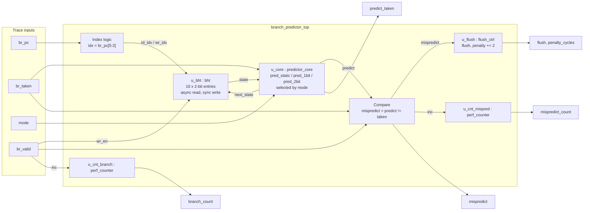

# Architecture Block Diagram

Author: Chaitanya, Dynamic Branch Prediction Unit (MCA Project 5)

Top module: [`rtl/branch_predictor_top.v`](../../rtl/branch_predictor_top.v). Port and module
details: [`docs/interface_spec.md`](../interface_spec.md). Exported image:
[`block_diagram.png`](block_diagram.png).

## How it works (one branch per clock)

1. **Index.** The branch PC selects one of 16 Branch History Table (BHT) entries with
   `pc[5:2]`. Bits `[1:0]` are skipped because instructions are 4-byte aligned.
2. **Read.** The BHT returns the 2-bit `state` of that entry combinationally.
3. **Predict.** `predictor_core` uses `mode` to choose the static (always not-taken), 1-bit or
   2-bit predictor. The 1-bit and 2-bit predictors predict with `state[1]`.
4. **Compare.** The prediction is compared with the actual outcome `br_taken` from the trace.
   A difference raises `mispredict` (and `flush`) in the same cycle.
5. **Update.** On the next rising clock edge the BHT entry is overwritten with `next_state`,
   the branch counter increments, and on a misprediction the misprediction counter increments
   and `penalty_cycles` grows by 2.

| Module | Instance | Function | Owner |
|---|---|---|---|
| `bht` | `u_bht` | 16 x 2-bit table of predictor states | Yashvi |
| `predictor_core` | `u_core` | Selects static / 1-bit / 2-bit by `mode` | Mouli |
| `pred_static`, `pred_1bit`, `pred_2bit` | inside `u_core` | Prediction and next-state logic | Mouli |
| `flush_ctrl` | `u_flush` | Flush request and penalty accounting | Aradhya |
| `perf_counter` | `u_cnt_branch`, `u_cnt_mispred` | 32-bit event counters | Aradhya |
| `branch_predictor_top` | top | Integration | Aradhya |
