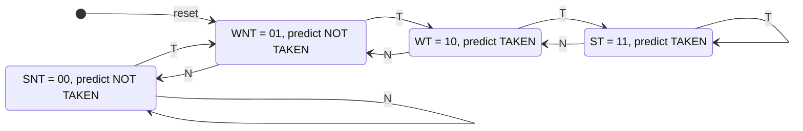
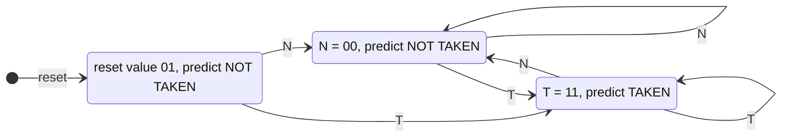

# Predictor State Diagrams (1-bit and 2-bit)

Author: Anuj, Dynamic Branch Prediction Unit (MCA Project 5)

Every Branch History Table (BHT) entry holds a 2-bit `state`. The predictor reads the entry
for the current branch, predicts with the **MSB** (`state[1]`), and after the real outcome is
known writes back `next_state`. All entries reset to `01`. RTL: [`rtl/pred_2bit.v`](../../rtl/pred_2bit.v),
[`rtl/pred_1bit.v`](../../rtl/pred_1bit.v). Directed tests: [`tb/tb_predictors.v`](../../tb/tb_predictors.v).

`T` = branch actually taken, `N` = branch actually not taken.

---

## 1. 2-bit saturating counter (mode 2)

| State | Bits | Prediction | Actual T → | Actual N → |
|---|---|---|---|---|
| Strongly Not-Taken (SNT) | `00` | NOT TAKEN | `01` WNT | `00` SNT (saturates) |
| Weakly Not-Taken (WNT) | `01` | NOT TAKEN | `10` WT | `00` SNT |
| Weakly Taken (WT) | `10` | TAKEN | `11` ST | `01` WNT |
| Strongly Taken (ST) | `11` | TAKEN | `11` ST (saturates) | `10` WT |

A taken branch counts **up** and a not-taken branch counts **down**, stopping at `11` and `00`.
The prediction is the MSB, so `00`/`01` predict not taken and `10`/`11` predict taken. To flip
the prediction from a strong state takes **two** wrong outcomes in a row.

---

## 2. 1-bit last-outcome predictor (mode 1)

The 1-bit predictor uses the same 2-bit BHT entry, but always writes `{taken, taken}`, so after
the first update an entry is only ever `00` or `11`. It has one bit of information: what the
branch did last time.

| State | Bits | Prediction | Actual T → | Actual N → |
|---|---|---|---|---|
| Not taken last time | `00` | NOT TAKEN | `11` | `00` |
| (reset value) | `01` | NOT TAKEN | `11` | `00` |
| Taken last time | `11` | TAKEN | `11` | `00` |

---

## 3. Why the 2-bit counter mispredicts once per loop and the 1-bit predictor twice

The `loop` trace is a 10-iteration loop branch (`T`×9 then `N`), executed 20 times = 200 branches.
The table shows branches 8–11 around the first loop exit, taken from the system testbench
(`vvp build/sim +trace=traces/loop.mem +mode=<1|2> +table`):

| Branch # | Actual | 1-bit state → predict | 1-bit result | 2-bit state → predict | 2-bit result |
|---|---|---|---|---|---|
| 8 | T | `11` → T | correct | `11` → T | correct |
| 9 (loop exit) | **N** | `11` → T | **mispredict** | `11` → T | **mispredict** |
| 10 (next loop starts) | T | `00` → N | **mispredict** | `10` → T | correct |
| 11 | T | `11` → T | correct | `11` → T | correct |

- **1-bit:** the single not-taken exit overwrites the entry with `00`, so the first iteration of
  the *next* loop is predicted not taken as well. That gives **2 mispredicts at every loop boundary**:
  20 exits + 19 re-entries + 1 warm-up (the entry starts at `01`) = **40 / 200 → 80.00 %**.
- **2-bit:** the exit only moves the counter from `11` (strong) to `10` (weak), which still
  predicts taken, so the next loop starts correctly. That gives **1 mispredict per loop**:
  20 exits + 1 warm-up = **21 / 200 → 89.50 %**.
- Static always-not-taken is wrong on every taken branch: **180 / 200 → 10.00 %**.

Waveforms of exactly this loop exit: [`loop_1bit.png`](../waveforms/loop_1bit.png) (two `mispredict`
pulses per boundary) and [`loop_2bit.png`](../waveforms/loop_2bit.png) (one pulse per boundary).

**Limitation:** the alternating trace (`T,N,T,N,…`) makes the 2-bit counter bounce between `01`
and `10`, which is wrong every time (0.00 %). The 1-bit predictor is also 0.00 %, and static
not-taken is better at 50.00 %. A predictor that remembers a *pattern* of outcomes, such as a
two-level or correlating predictor, is needed for this case.
