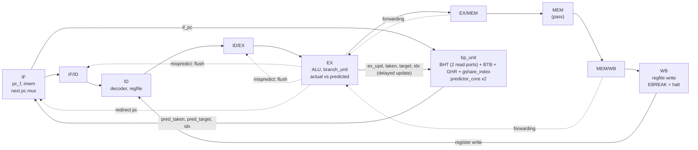

# 5-Stage Pipeline with the Branch Prediction Unit (Phase 2)

Author: Chaitanya, Dynamic Branch Prediction Unit (MCA Project 5)

RTL: [`rtl/cpu/pipeline_cpu.v`](../../rtl/cpu/pipeline_cpu.v) and
[`rtl/bp_unit.v`](../../rtl/bp_unit.v). Exported image: [`pipeline_diagram.png`](pipeline_diagram.png).

## How a branch moves through the pipeline

| Cycle | Stage | What happens to the branch |
|---|---|---|
| 1 | IF | `bp_unit` reads BHT port 1 (index `pc[5:2]`, or XOR history in gshare mode) and the BTB. If the direction is "taken" **and** the BTB hits, the next fetch is the BTB target; otherwise `pc + 4`. The index used is stored in IF/ID. |
| 2 | ID | Decoded; `rs1`, `rs2` read from the register file. |
| 3 | EX | `branch_unit` computes the real outcome and target. If the real next PC differs from the one fetched, `flush` clears IF/ID and ID/EX (2 wrong-path instructions = 2 cycles) and fetch restarts at the correct PC. `bp_unit` is updated: BHT port 2 reads the entry, the new state is written, a taken branch is written into the BTB, and the outcome is shifted into the GHR. |
| 4–5 | MEM, WB | Nothing more for a branch (it writes no register). |

Because the update happens in EX, a branch fetched less than 2 cycles after another branch
still sees the old table state and the old global history. In our programs this changes the
results only for gshare (see the report, Results and Discussion).
